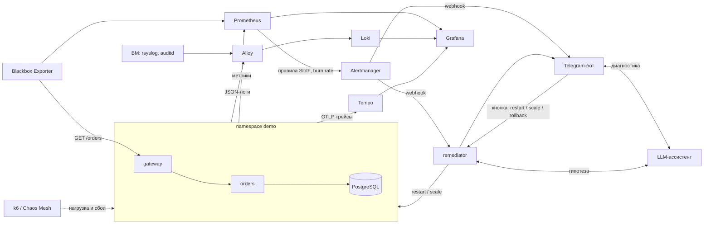

# SRE-платформа наблюдаемости

Кейс хакатона «Телеком будущего»: платформа, которая следит за сервисом, считает SLO, замечает сбои и сама восстанавливает сервис.

## Описание проблемы

В распределенной системе сбой замечают поздно, а чинят вручную: дежурный должен увидеть алерт, найти причину в метриках, логах и трейсах и выполнить команду.
Это долго (минуты), результат зависит от человека, а у данных нет единой картины: метрики, логи и трейсы лежат в разных местах.
Нужна платформа, которая: измеряет качество сервиса через SLO, ловит сбой по скорости сгорания бюджета ошибок, объясняет вероятную причину и безопасно исправляет типовые сбои без участия человека.

## Цель работы

Собрать и показать работающий контур SRE на демо-сервисе `gateway → orders → PostgreSQL`:
1. метрики, логи и трейсы в одной системе, связанные между собой (метрика → трейс → лог);
2. SLO как код, алерты по burn rate, внешние синтетические пробы;
3. автоматическое восстановление (restart / scale) с предохранителями и аудитом;
4. LLM-ассистент с гипотезой причины, не принимающий решений сам;
5. Telegram-уведомления;
6. хаос-тесты и измеренное MTTR «вручную» и «с автоматикой»;
7. все поднимается из кода одной командой.

## Состав команды

| Роль | Участник | Зона ответственности |
|---|---|---|
| Dev A | Максим Гетманец (МАИ) | Alertmanager, Telegram-бот (Go), трассировка, mTLS |
| Dev B | Александр Володин (МАИ) | remediator, LLM-ассистент, CI и образы в ghcr, синтетические пробы, хаос-сценарии, замеры MTTR и нагрузочные тесты, SLO-документация |
| PM | Дарья Зверева (ВШЭ) | требования, runbooks, документация, защита |

## Архитектура



Метрика → трейс → лог связаны в Grafana: в JSON-логе есть `trace_id`, из Loki ссылка ведет в Tempo (и обратно, трейс → логи).

| Каталог | Что внутри |
|---|---|
| `apps/` | demo-сервисы `gateway → orders → PostgreSQL` (Java 21, Spring Boot 3.4), ручки имитации сбоев, Helm-чарт |
| `observability/` | `dashboards/` (Grafana как код), `alerts/` (правила Sloth и синтетика), `slo/` (спецификации SLO) |
| `remediator/` | Python: webhook Alertmanager, таблица политик, предохранители, аудит |
| `llm/` | LLM-ассистент (FastAPI) |
| `tgbot/` | Telegram-бот на Go: работает в кластере (Dockerfile, Helm-чарт), чаты подключаются командой `/start` |
| `chaos/` | сценарии Chaos Mesh (`experiments/`), внесение сбоев и замер MTTR |
| `load/` | нагрузочные тесты k6 |
| `terraform/` | helm-релизы всего стека |
| `ansible/` | подготовка ВМ: ssh, ufw, fail2ban, k3s, rsyslog, auditd |
| `docs/` | `slo.md`, `runbooks/`, `results/` |

## Использованные инструменты

| Область | Инструменты |
|---|---|
| Кластер | k3s v1.28.15 (на ВМ), k3d (локально) |
| IaC | Terraform 1.5 (provider helm 2.17), Helm, Ansible |
| CI | GitHub Actions (тесты, `helm lint`, gitleaks, сборка образов в `ghcr.io`) |
| Метрики и алерты | kube-prometheus-stack (Prometheus, Alertmanager, Grafana), Sloth v0.16 (SLO как код), Blackbox Exporter |
| Логи и трейсы | Loki, Grafana Alloy, Tempo, OpenTelemetry agent |
| Приложения | Java 21, Spring Boot 3.4 (Micrometer), PostgreSQL 16 |
| Автоматизация | Python 3.12 (FastAPI): remediator, LLM-ассистент; Go: Telegram-бот |
| Надежность | Chaos Mesh 2.8, k6 0.54 |
| ОС хоста | Ubuntu 22.04, rsyslog, auditd, ufw, fail2ban |

## Как запустить

Нужны: Docker, k3d, kubectl, Terraform 1.5+, make.

```bash
git clone https://github.com/MaksimGetmanets/telecom_future_sre.git
cd telecom_future_sre
make up        # k3d-кластер, образы, весь стек и demo-сервисы
kubectl -n demo get pods
```

Необязательные секреты (без них все работает, но без Telegram и внешней LLM; значения только из окружения, в git не попадают):

```bash
export TF_VAR_telegram_token=...                  # токен бота от @BotFather; без него бот пишет алерты в лог пода
export TF_VAR_remediator_dry_run=false            # реальные действия (по умолчанию dry-run)
export TF_VAR_openai_api_key=...                  # внешняя LLM (без ключа ассистент работает по правилам)
```

Telegram: после `make up` откройте своего бота и отправьте ему `/start`, чат подключится сам (chat id вводить не нужно, см. «Telegram-бот»).

После правок кода: `make apps-reload`. Остановить: `make down`.

### На ВМ (k3s)

Запускается на самой ВМ из корня репозитория:

```bash
make vm-setup                                    # ansible: ssh, ufw, k3s, terraform, логи хоста
export KUBECONFIG=$PWD/kubeconfig-sre.yaml
export TF_VAR_remediator_dry_run=false
make deploy DEPLOY_APPS=yes IMAGE_TAG=develop    # стек + demo из ghcr.io/maksimgetmanets
make deploy-status
```

Образы `sre-gateway`, `sre-orders`, `sre-remediator`, `sre-llm-assistant` публикует CI в `ghcr.io` (теги `develop`, `main`, `sha-<commit>`), пакеты должны быть публичными.

### Доступ к интерфейсам

```bash
kubectl -n monitoring port-forward svc/kps-grafana 3000:80                                   # Grafana (admin / prom-operator, на ВМ сменить)
kubectl -n monitoring port-forward svc/kps-kube-prometheus-stack-alertmanager 9093:9093      # Alertmanager
kubectl -n monitoring port-forward svc/kps-kube-prometheus-stack-prometheus 9090:9090        # Prometheus
```

### Демо: сбой → алерт → самовосстановление

```bash
kubectl -n demo port-forward svc/gateway 8080:8080 &
while true; do curl -s -o /dev/null localhost:8080/orders; sleep 0.2; done &   # фоновый трафик, без него алерт не сработает
chaos/fault.sh orders 'errorRate=0.5'              # 50% ошибок на orders
kubectl -n demo get pods -w                        # через 1–2 минуты remediator перезапустит поды
kubectl get --raw /api/v1/namespaces/monitoring/services/remediator:8080/proxy/audit   # решение remediator
chaos/fault.sh orders clear                        # снять сбой вручную
```

Задержка: `chaos/fault.sh orders 'delayMs=600'`. Chaos Mesh: `make chaos-enable`, затем `make chaos-run SCENARIO=orders-pod-kill` (также `orders-network-delay`, `orders-cpu-stress`), аварийно `make chaos-stop`.
Тесты: `make apps-test`, `make remediator-test`, `make tgbot-test`, `make load-smoke`, `make load-capacity`.

## Мониторинг и наблюдаемость

**SLO.** Цели: доступность 99,5%, latency 95% запросов быстрее 300 мс, внешняя проба 99,5%, окно 30 дней.
Правила burn rate генерирует Sloth (`make slo-gen`, спецификации в `observability/slo/`). Для демо окна короткие (1 и 5 мин), сбой замечается за ≈ 1 минуту.
Подробно: [`docs/slo.md`](docs/slo.md).

**Алерты** приходят в Alertmanager с лейблами `namespace=demo`, `deployment`, `severity=page` и ссылкой `runbook_url` (каталог `docs/runbooks/`).
Маршрут: remediator и Telegram-бот. Дедупликация: `inhibit_rules` не шлют симптомы (gateway, внешние пробы), пока горит алерт первопричины (orders), см. `terraform/values/alertmanager.yaml`.

**Дашборды** (Grafana как код, `observability/dashboards/`): `demo-shop-slo` (SLI, burn rate, остаток бюджета), `demo-shop-health` (поды, JVM, соединения, логи), `k6-capacity`, синтетические пробы.

**Логи и трейсы.** JSON-логи с `trace_id` попадают в Loki через Alloy, трейсы в Tempo. Логи и аудит хоста ВМ (`sshd`, `sudo`, события `auditd` с ключами `sre_*`): запрос `{job="host-syslog"}`.

**Синтетические пробы.** Blackbox Exporter раз в 15 с запрашивает `GET /orders` у gateway и orders. Алерты `SyntheticProbeFailed`, `SyntheticSloBurn`.

**Автоматическое восстановление (remediator).** По таблице [`remediator/policies.yaml`](remediator/policies.yaml) выполняет restart, scale или rollback (откат на предыдущую ревизию). Каждое решение пишется в аудит (`GET /audit`, stdout в Loki) и в метрики `remediator_*`. Подробно: [`remediator/README.md`](remediator/README.md).

**Результаты замеров** ([`docs/results/mttr.md`](docs/results/mttr.md), сырые данные в `.csv`). MTTR: от внесения сбоя до 5 успешных проб подряд.

| Сценарий | Вручную, с (ноутбук) | С remediator, с (ноутбук) | С remediator, с (ВМ) |
|---|---|---|---|
| Всплеск 5xx на orders | 180 (80–290) | 95 (90–111) | 118 |
| Рост латентности на orders | 199 (177–272) | 132 (121–136) | 146 |

Алерт срабатывает через 50–80 с. SLO выполняются до 200 запросов/с (2 реплики gateway по 1 ядру). Результаты сценариев Chaos Mesh (pod-kill, network-delay, cpu-stress): [`docs/chaos.md`](docs/chaos.md).

## Telegram-бот

Бот (`tgbot/`, Go) работает **внутри кластера** (сервис `tgbot.monitoring.svc:8080`), поднимается вместе со стеком и принимает вебхук Alertmanager. Для сообщения об алерте он:
1. сразу отправляет алерт (уведомление не теряется, даже если ассистент недоступен);
2. запрашивает у `llm-assistant` диагноз и дописывает его в это же сообщение: гипотеза, уверенность, улики, предложенное действие;
3. если ассистент предложил проверенное действие (`restart`, `scale` или `rollback`), показывает кнопки «Выполнить» и «Отклонить».
Бот ничего не решает сам: нажатие вызывает `POST /execute` у remediator, а тот применяет те же ограничения, что и к автоматике (белый список namespace и действий, cooldown, лимит в час, dry-run). Результат пишется в аудит (`manual_remediation`).

**Как подключить свой чат (chat id искать не нужно):**
1. Создайте бота у [@BotFather](https://t.me/BotFather) и получите токен.
2. `export TF_VAR_telegram_token=<токен>` и `make up` (на ВМ: `make deploy DEPLOY_APPS=yes`).
3. Откройте бота в Telegram и отправьте `/start`: бот запомнит чат и ответит его id. Отключить: `/stop`.

Без токена платформа работает полностью, а алерты и диагноз пишутся в лог пода (`kubectl -n monitoring logs deploy/tgbot`). Это удобно для проверки без Telegram: `make tgbot-fire` отправляет тестовый алерт (нужен `kubectl -n monitoring port-forward svc/tgbot 8090:8080`).

Необязательные настройки: `TF_VAR_telegram_chat_id` (закрепить чат заранее, несколько через запятую), `TF_VAR_telegram_register_code` (подключение только по `/start <код>`). Список подключённых чатов хранится в поде и сбрасывается при его пересоздании, тогда достаточно снова отправить `/start`. Кнопки принимаются только из подключённых чатов и устаревают через 30 минут.

## Безопасность

- **Секреты** не хранятся в git: переменные Terraform `TF_VAR_*`, ansible-vault, `.env` в `.gitignore`; в CI проверка gitleaks.
- **Remediator безопасен по умолчанию:** режим dry-run, действует только в namespace `demo`, пауза между одинаковыми действиями 180 с, не больше 6 действий в час на deployment, потолок числа реплик, RBAC только в `demo`: изменение `deployments`, чтение `replicasets` (для отката), аудит каждого решения. Webhook поддерживает токен `Authorization: Bearer` (в демо не включен).
- **Chaos Mesh** бьет только по namespace с аннотацией `chaos-mesh.org/inject=enabled`: `monitoring` и `kube-system` защищены.
- **ВМ:** вход по ssh-ключам, ufw, fail2ban, аудит входов и команд (auditd) уходит в Loki.
- **Ручки имитации сбоев** (`/fault`, `/slow`, `/fail`, `/leak`) в demo-сервисах не защищены; в боевом режиме отключаются `FAULTS_ENABLED=false`.
- **Образы:** собираются в CI и публикуются в `ghcr.io`, у каждого коммита свой тег `sha-<commit>`.

## Использование LLM

Сервис `llm-assistant` (FastAPI) по алерту разбирает контекст, в том числе логи сервиса, и возвращает гипотезу причины, уверенность, улики и рекомендуемое действие (`POST /diagnose`).
Remediator сравнивает рекомендацию с решением таблицы политик (поле `agrees` в аудите).

- LLM **не выполняет действий**: решает всегда детерминированная таблица политик, рекомендация проходит валидацию (`validated`).
- Без ключа ассистент работает по правилам (`model: "rules"`), платформа от него не зависит.
- Внешний провайдер (OpenAI-совместимый API) подключается через ключ в `TF_VAR_*`; ключ в git не хранится.
- Пример расхождения: на сбое `orders` политика перезапустила и `orders`, и `gateway`, а LLM по логам указала причину в `orders` и что restart gateway не нужен (`agrees: false`).
- Гипотеза, улики и предложенное действие дописываются в Telegram-сообщение об алерте; действие выполняется только после нажатия кнопки (см. «Telegram-бот»).

## Troubleshooting

| Симптом | Причина и решение |
|---|---|
| `ImagePullBackOff` у demo-сервисов на ВМ | образа нет в ghcr или пакет приватный. Проверьте тег (`IMAGE_TAG=develop`) и что пакеты `sre-*` публичные |
| `kubectl`: `localhost:8080 connection refused` | не задан kubeconfig: `export KUBECONFIG=$PWD/kubeconfig-sre.yaml` |
| `bind: address already in use` при `port-forward` | порт занят чужим процессом: `ss -ltnp \| grep <порт>`, возьмите другой локальный порт (`8081:8080`) |
| remediator ничего не делает, в аудите `dry_run` | деплой без `remediator_dry_run=false`: каждый `make deploy` сбрасывает флаг, экспортируйте `TF_VAR_remediator_dry_run=false` |
| В аудите `skipped_guard` | сработали cooldown 180 с или лимит 6 действий в час. Подождите или перезапустите remediator: `kubectl -n monitoring rollout restart deploy/remediator` (счетчики в памяти) |
| Алерты не доходят до remediator и Telegram | Alertmanager отклонил конфиг (нет секции `receivers` или опечатка): `kubectl -n monitoring logs alertmanager-kps-kube-prometheus-stack-alertmanager-0 -c alertmanager \| grep -i error` |
| В Telegram нет сообщений | бот работает в кластере: `kubectl -n monitoring logs deploy/tgbot`. Строка `[HINT] ни один чат не подключён`: отправьте боту `/start`. `Режим без Telegram`: не задан `TF_VAR_telegram_token`. Два экземпляра бота с одним токеном (например, старый на хосте) конфликтуют: оставьте один |
| Chaos Mesh не применяет эксперимент | на namespace нет аннотации: `make chaos-enable`; для k3s в `terraform/values/chaos-mesh.yaml` задан runtime `containerd` |
| `make chaos-run` отказывается стартовать | горит алерт (например `SyntheticSloBurn` после недавнего простоя), он гаснет до 30 минут; скрипт сам ждет тишины (`--wait-quiet`) |
| Замер MTTR сильно выше обычного | пауза между прогонами меньше cooldown remediator: `--pause 200` |
| Нет доступа к Grafana на ВМ | порт ВМ не проброшен: SSH-туннель `ssh -L 3000:127.0.0.1:3000 ...` или правило проброса в VirtualBox |
| `make vm-setup` падает на скачивании kubectl (`deploy_tools`) | известная проблема проверки контрольной суммы; логи хоста можно поставить отдельно `--tags host_logs` |

## Лицензия

Проект создан в рамках хакатона «Телеком будущего». Лицензия MIT.
